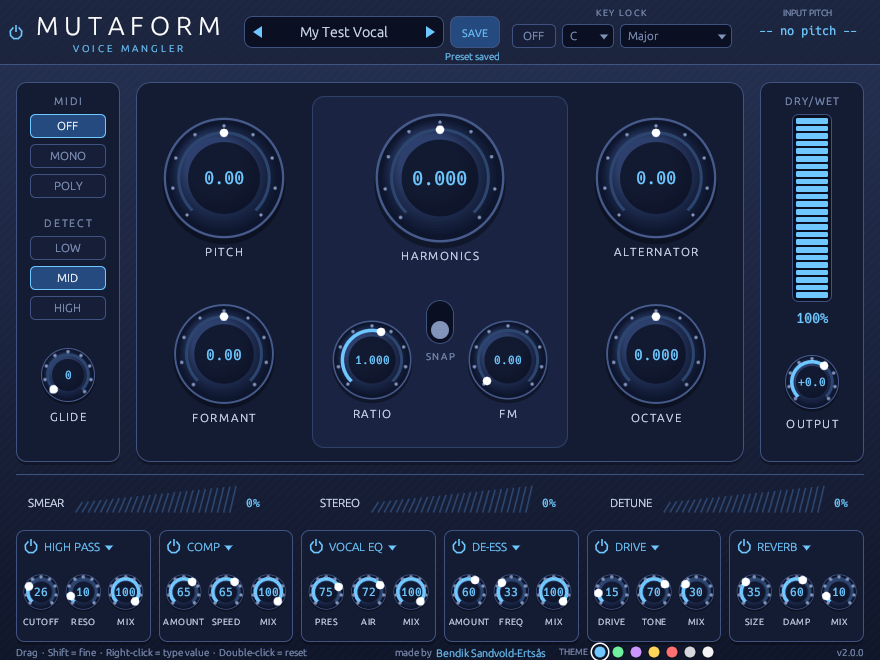
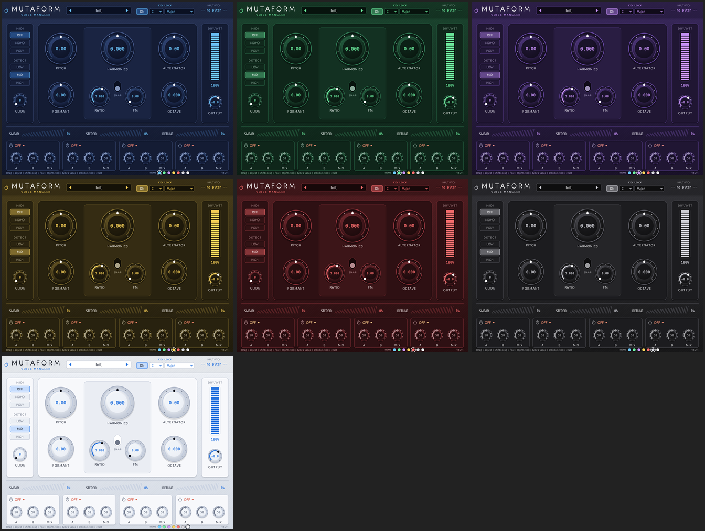

# Mutaform: voice mangler (VST3 / CLAP for Windows and macOS)

Made by **Bendik Sandvold-Ertsås**.

Mutaform is an effect plugin for pitch, formant and harmonic manipulation of vocals, with a full vocal effects chain built in. It is written in Rust using [nih-plug](https://github.com/robbert-vdh/nih-plug). The pitch and formant shifting is done by the [Rubber Band Library](https://breakfastquay.com/rubberband/), a proven professional pitch-shifting engine. No code or graphics were taken from the product that inspired it.

## Installation (Windows)

1. Right-click **Installer.bat** and choose **Run as administrator**.
   It copies `Mutaform.vst3` to `C:\Program Files\Common Files\VST3\` and `Mutaform.clap` to `C:\Program Files\Common Files\CLAP\`.
   You can also copy the files there yourself.
2. Open FL Studio and go to **Options → Manage plugins → Find more plugins**. Mutaform will show up under *Effects*.
3. Put Mutaform on a Mixer track, for example your vocal track.

## Installation (macOS)

Mac versions have to be built on a Mac (Apple's tools only run there). There are two ways; neither costs anything.

**A. Let GitHub build it (no Mac tools needed)**

1. Create a free account at github.com, make a new repository and upload the contents of `Mutaform-source.zip`, including the hidden `.github` folder.
2. Open the **Actions** tab. The *Build Mutaform* workflow runs automatically; if it doesn't, click *Run workflow*.
3. When it finishes (about 10 minutes), download **Mutaform-macOS** under *Artifacts* and unzip it.
4. Double-click **Install-Mac.command**. If macOS refuses to open it, right-click it → *Open*.

**B. Build it on the Mac**

1. In Terminal, install Apple's tools with `xcode-select --install`, then Rust from https://rustup.rs.
2. Unzip `Mutaform-source.zip`, open Terminal in the `mutaform` folder and run `bash scripts/build-macos.sh --install`.

Either way you get a universal plugin (Intel and Apple Silicon) installed to `~/Library/Audio/Plug-Ins/VST3` and `~/Library/Audio/Plug-Ins/CLAP`. Then run *Find more plugins* in FL Studio. The installer removes macOS's "downloaded from the internet" flag, because the plugin isn't notarized by Apple.

## Presets

Click the preset name at the top to open the list, or step through presets with the arrows.

- **Vocal chains** are complete mix-ready chains with no pitch change: high-pass, compressor, vocal EQ, de-esser, delay and reverb. They are Clean Pop Vocal, Radio Ready, Big Hall Ballad, Trap Lead, Intimate & Dry, Wide Hook, Double Tracked, Echo Throw, Whisper Air, Ambient Wash, Lo-Fi Bedroom, Telephone and Key Locked Pop. The last one turns on Key Lock; set the key of your song yourself.
- **Character** presets change pitch or formants: Deep Ogre, Helium, Gender Flip, Big Guy, Chipmunk Chop, Octave Down Ad-lib and Octave Stack.
- **Sound design** presets are creative effects: Robot Choir, Sub Alternator, Hollow Down, FM Growl, Metal Throat, Smear Cloud and Wobble Monster.
- **MIDI** presets play the vocal from MIDI notes: MIDI Mono Lead and MIDI Poly Harmonizer.

The vocal chains are a starting point. Adjust the compressor AMOUNT and the reverb/delay MIX to taste, since every recording is different.

**Your own presets:** set everything the way you like, click **SAVE**, type a name and press Enter. Your presets appear under *MY PRESETS* in the list, where the **x** next to a preset deletes it. Saving with an existing name overwrites that preset. *Open presets folder* shows where the files are, so you can back them up or share them:

- Windows: `%APPDATA%\Mutaform\Presets`
- macOS: `~/Library/Application Support/Mutaform/Presets`

## Controls

| Control | What it does |
|---|---|
| **PITCH** | Transposes ±24 semitones while keeping the formants (the character of the voice). |
| **FORMANT** | Shifts the formants ±12 semitones without changing the pitch. Turning it down sounds "big/dark"; turning it up sounds "small/bright". |
| **HARMONICS** | Shifts every overtone by a fraction of the fundamental, for metallic and robotic tones. |
| **RATIO** | Ratio between the FM modulator and the fundamental. |
| **FM** | Frequency modulation that follows the pitch: growl, buzz and bell-like tones. |
| **SNAP** | Locks Harmonics to steps of 0.25 and Ratio to whole ratios (1, 2, 3 … or ½, ⅓ …) so the result stays musical. |
| **ALTERNATOR** | Treats every other pitch cycle differently. Positive values give a buzzy sub-octave; negative values give a hollow octave down. |
| **OCTAVE** | Blends in an octave below (turn left) or above (turn right). |
| **SMEAR** | Turns the voice into an airy, choir-like cloud. |
| **STEREO** | Widens the sound in the stereo field. |
| **DETUNE** | Adds a doubled voice on each side, slightly sharp and slightly flat. |
| **GLIDE** | Portamento between MIDI notes and when the pitch changes, 0–1000 ms. |
| **DETECT** | Frequency range used by the pitch detector: LOW (bass and deep voices), MID (normal vocals) or HIGH (high voices, whistle). |
| **MIDI** | OFF: the Pitch knob is in control. MONO/POLY: MIDI notes set the pitch (a vocoder-style harmonizer, up to 8 voices in POLY). The MIDI modes force every note to an exact pitch, so they intentionally sound more synthetic/robotic. |
| **KEY LOCK** (top bar) | Turn it ON and pick a key (C–B) and a scale (Major, Minor, Harm. Minor, Dorian, Mixolydian, Penta Major/Minor, Blues, Chromatic). Each note is pulled to the nearest note in the scale, while vibrato and natural movement are kept. The display on the right shows the note it is locking to ("LOCK → G3"). Key Lock works when MIDI is set to OFF. |
| **DRY/WET**, **OUTPUT** | Mix and output level. |
| **Power button** (top left) | Bypass with a smooth crossfade. This is the plugin's own bypass parameter, so automate it in FL Studio (right-click it → *Create automation clip*) instead of switching the mixer slot on and off. |
| **FX 1–6** | Six effect slots, processed left to right. Click the name to choose an effect and the power button to switch the slot on or off. The effects are listed below. |

| Effect | Knobs |
|---|---|
| **Comp** (compressor) | AMOUNT (more = lower threshold and higher ratio, with automatic make-up gain), SPEED (slow and smooth → fast and punchy) |
| **Vocal EQ** | PRES (presence around 3.5 kHz) and AIR (top end above 11 kHz). The middle position is flat; turning a knob gives up to ±9 dB. |
| **De-Ess** | AMOUNT, FREQ (4–10 kHz). Tames harsh S sounds. |
| **Low Pass / High Pass** | CUTOFF, RESO |
| **Drive** | DRIVE, TONE |
| **Chorus** | RATE, DEPTH |
| **Delay** | TIME is synced to the song tempo (1/32 … 1/1, including dotted and triplet values); FEEDBK. It is a ping-pong delay. |
| **Reverb** | SIZE, DAMP |
| **Crush** | BITS, RATE |
| **Tremolo** | RATE, DEPTH |

Every slot also has a MIX knob. A built-in safety limiter stops the processed signal from clipping above −0.2 dBFS.

Mouse: drag up and down to adjust a knob. **Shift + drag** adjusts in finer steps, **double-click** resets to the default, and the **scroll wheel** works too.
**Typing exact values:** right-click a knob or slider (or Ctrl + click it), type the value (for example `-7` for Pitch, or `35` for 35 %) and press **Enter**. **Esc** cancels.

**Color themes:** click one of the colored dots next to *THEME* at the bottom of the window: Blue (default), Green, Purple, Yellow, Red, Dark (gray) or White. The theme is saved with your FL Studio project.

## Controlling Mutaform with MIDI in FL Studio (MONO/POLY)

1. Set Mutaform to **MONO** or **POLY**.
2. Add a **MIDI Out** channel to the Channel Rack and set its **Port** to, for example, 1.
3. Open the Mutaform window, click the gear icon (wrapper settings) and set **MIDI input port** to the same number (1).
4. The notes you write in the Piano Roll on the MIDI Out channel now set the pitch of the vocal.

## Good to know

- Pitch effects work best on **monophonic** sources: a single voice, a lead or a bass. The vocal chains work on anything.
- **If parts of a song sound muddy or strange:**
  - Use a clean vocal track without reverb or backing vocals. If you only have the finished song, FL Studio 2024 and newer can pull out the vocal with **Stem separation** (right-click the audio clip).
  - Pick the right **DETECT** range: HIGH for bright voices, LOW for deep voices. This matters for Key Lock, Alternator, Harmonics/FM and the MIDI modes.
- With every knob at its default (the Init preset), Mutaform is fully transparent: the sound passes through untouched, only delayed by the latency.
- **Switching on and off with automation:** automate the power button (Bypass) or Dry/Wet for clean switching. If you switch the mixer slot itself on and off instead, FL Studio stops sending audio to the plugin. When it comes back on, the plugin starts clean and fades in, but there is a short gap (the latency).
- The plugin has about 90 ms of latency at 48 kHz, which high-quality pitch shifting needs. FL Studio compensates for this during playback, but you will hear the delay if you record live through the effect.
- Both VST3 and CLAP versions are included. FL Studio 2024 and newer support both, so use whichever you prefer.

## Building from source

The source code is in `Mutaform-source.zip`.

- **Windows:** install Rust from https://rustup.rs, then run `cargo build --release --lib` in the `mutaform` folder. Copy `target\release\mutaform.dll` to `Mutaform.vst3\Contents\x86_64-win\Mutaform.vst3` and/or to `Mutaform.clap`.
- **macOS:** run `bash scripts/build-macos.sh` (see *Installation (macOS)* above).
- **GitHub Actions:** `.github/workflows/build.yml` builds both platforms automatically.

Source files:

- `src/chain.rs`: the signal chain (Rubber Band path, MIDI path, effect layers, latency alignment)
- `src/rb.rs`: Rubber Band wrapper (real-time live shifter, latency compensation)
- `src/layers.rs`: key lock, alternator, detune doubler, smear cloud, stereo widener
- `src/fx.rs`: the effect slots (compressor, EQ, de-esser, delay, reverb …)
- `src/presets.rs`: factory presets and saving/loading user presets
- `src/editor.rs`: the user interface
- `src/engine.rs`: the PSOLA engine used for the MIDI modes
- `src/pitch.rs`: YIN pitch detection
- `src/lib.rs`: plugin setup, the harmonics/FM stage, safety limiter
- `third_party/rubberband/`: Rubber Band Library source (compiled automatically by `build.rs`)
- `scripts/`: macOS build script, installer and bundle template
- `examples/chain_render.rs`: an offline test that renders WAV files for every preset

## Version history

- 1.1.0: Key Lock; better pitch detection (fewer octave jumps and blips); cleaner s and t sounds.
- 1.1.1: no stutter when the plugin is inserted but nothing has been changed.
- 1.1.2: Bypass button with a smooth crossfade; no glitch when switching the plugin back on.
- 1.2.0: type exact values (right-click any control); steadier pitch shifting.
- 1.2.1: steadier Key Lock.
- 1.3.0: seven color themes.
- 1.3.1: "made by" credit and vendor name in FL Studio.
- 2.0.0: new pitch engine (Rubber Band), so no more warbling, robotic or stuttering pitch shifting. Octave, Detune, Smear, Stereo and Alternator were rebuilt.
- 2.1.0: 30 presets, including 13 complete vocal chains; save, load and delete your own presets; six effect slots; new Compressor, Vocal EQ and De-Esser effects; tempo-synced delay; output safety limiter; macOS support (universal, built with the included script or GitHub Actions).

## Credits

- Pitch and formant shifting: Rubber Band Library, Copyright © 2007–2024 Particular Programs Ltd, licensed under the GNU GPL (version 2 or later). See `third_party/rubberband/COPYING` in the source.
- Plugin framework: nih-plug by Robbert van der Helm.

License: GPL-3.0, because nih-plug's VST3 bindings and Rubber Band are GPL. That is fine for using it in your own music. If you ever want to sell the plugin, Rubber Band offers a commercial license.
